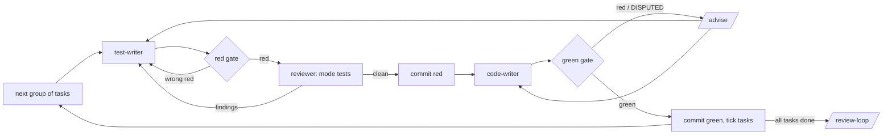

# TDD loop — test-writer → red gate → test review → code-writer → green gate

You are the **orchestrator**. You own the gates; the agents never grade their own work.
You do not write tests or app code yourself in this loop. `role-guard` keeps the
`test-writer` on test files and the `code-writer` on app code; you commit.

Run it only when the PR has `plan:approved` and not `plan:review` (Plan-first step 4).



## 0. Plan the groups

Read `openspec/changes/<id>/tasks.md`, the delta specs and `design.md`. Work one `##`
group of `tasks.md` at a time (tasks that only change config or docs need no tests: do
them yourself). For each group, list the scenarios (WHEN / THEN) it covers.

## 1. Tests — `test-writer`

`Agent(subagent_type: "test-writer", run_in_background: false)` with: the change id, the
task ids, the scenarios, the target files from `design.md`, and the level per scenario
(API e2e for HTTP behaviour, unit for service logic, Vitest for web).

## 2. Red gate (you)

Run the tests it reported yourself (commands in its agent file). Pass only when:

- every new test fails, on an assertion about the target behaviour (or a missing symbol
  that does not exist yet);
- `git status --short` shows only test files changed;
- every scenario of the group appears in its `SCENARIOS` line.

Otherwise send it back to the `test-writer` with the output.

## 3. Test review — `reviewer`, mode `tests` (at most 3 passes)

`Agent(subagent_type: "reviewer")` with: `mode: tests`, the change id, the task ids, the
test files, and what you were unsure about. Route every blocker / major finding to the
`test-writer`, re-run the red gate, review again. Pass 3 still not clean: stop the loop
and report it as blocked (put the open findings in the PR body). A spec question goes to
`/advise` first.

On clean: commit the tests alone — `test: <scenario or task> (red)`. Write down the
commit sha: the green gate compares against it.

## 4. Code — `code-writer`

`Agent(subagent_type: "code-writer", run_in_background: false)` with: the failing test
ids, the change id, the task ids and the `GAPS` line of the test-writer. Do not
paraphrase the tests; it reads them.

## 5. Green gate (you)

```bash
pnpm --filter <app> test                       # whole unit suite
pnpm --filter api test:e2e                     # when the group touched API routes, DTOs, entities or migrations
pnpm lint && pnpm typecheck
git diff --stat <red sha> -- '*.spec.ts' '*.test.ts' '*.test.tsx' '*.e2e-spec.ts' apps/api/test apps/web/src/test
```

The last command must print nothing: tests do not change in the green phase. `DISPUTED`
or `DESIGN` in the code-writer's report: run `/advise`, then route as it says. Never let
either agent settle a dispute alone.

On green: tick the group's tasks in `tasks.md`, commit — `feat: <what>` (or `fix:`) —
and continue with the next group.

## 6. After the last group

Run the whole suite once (`pnpm test`, `pnpm --filter api test:e2e`, `pnpm lint`,
`pnpm typecheck`), then `/review-loop` on the whole change. The `review-gate` Stop hook
holds the turn until a review pass is clean.

## Hard rules (both agents, and you)

- Never delete, `.skip`, `.only` or weaken a test to get green (`toBe(409)` →
  `toBeGreaterThan(399)`, exact fields → `toBeDefined()`).
- Never commit code before its red test.
- A spec or design question goes to `/advise`; a plan that turns out wrong goes back
  through `/opsx:update` and `plan:review` (Plan-first step 5).
