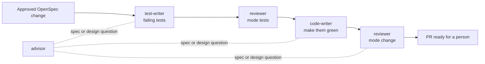
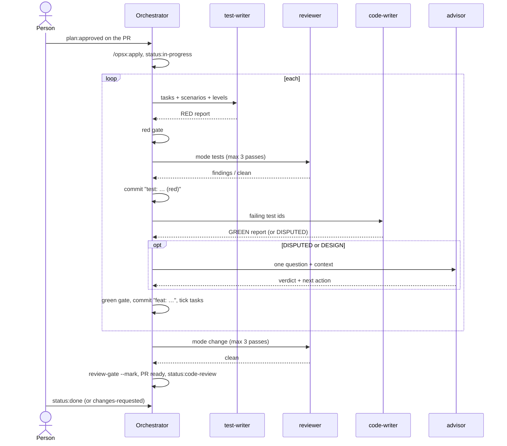

# Agent workflow (L5d)

How a feature goes from an approved OpenSpec change to a reviewed pull request with four
Claude Code agents. The rules live in `CLAUDE.md` (Plan-first, Agents) and in the agent
and skill files; this page explains how the pieces fit, what each gate checks and what to
do when something goes wrong.

- [The idea in one picture](#the-idea-in-one-picture)
- [Roles](#roles)
- [End to end](#end-to-end)
- [The TDD loop](#the-tdd-loop)
- [Test levels](#test-levels)
- [Test review](#test-review)
- [The review loop](#the-review-loop)
- [The advisor](#the-advisor)
- [What the hooks enforce](#what-the-hooks-enforce)
- [Commits and the pull request](#commits-and-the-pull-request)
- [When things go wrong](#when-things-go-wrong)
- [Cost](#cost)
- [Limits and what is not covered](#limits-and-what-is-not-covered)
- [Files](#files)

## The idea in one picture

Nobody grades their own work. The agent that writes the tests cannot write the code, the
agent that writes the code cannot touch the tests, and the reviewer cannot change
anything. The session that runs `/opsx:apply` is the **orchestrator**: it runs the gates
between the agents and makes the commits, but it does not write tests or app code itself.



## Roles

| Role | Model | May write | Job | Reports |
|---|---|---|---|---|
| **Orchestrator** (your session in the task's worktree) | session model | everything the normal hooks allow | Plans the groups, runs the red and green gates, commits, ticks `tasks.md`, routes findings | the PR |
| `test-writer` | sonnet | test files only | Writes failing tests from the change's scenarios and proves they fail for the right reason | `RED / FILES / TESTS / SCENARIOS / GAPS` |
| `code-writer` | sonnet | app code under `apps/*/src` only | The narrowest change that turns the tests green | `GREEN / FILES / CHANGE / DISPUTED / DESIGN` |
| `reviewer` | opus | nothing | Mode `tests`: the new tests, before any code. Mode `change`: the whole change | ranked findings and a `VERDICT` |
| `advisor` | opus | nothing | One blocking spec or design question: which source governs, quoted, and one next action | `QUESTION / CLASS / SOURCES / VERDICT / NEXT ACTION` |

"Test files" are `*.spec.ts`, `*.test.ts(x)`, `*.e2e-spec.ts`, anything under
`apps/api/test/` and `apps/web/src/test/`. "App code" is everything else under
`apps/api/src/` and `apps/web/src/` (migrations included). Neither writer may touch
specs, `package.json`, config, tooling or docs.

## End to end

The agents sit inside the Plan-first flow of `CLAUDE.md`. Steps 1–3 and 7–8 are unchanged.



1. **Start.** The PR has `plan:approved` and not `plan:review`. In the task's worktree
   (`pnpm task:new <change-id>`, then `cd .worktrees/<change-id> && claude`), run
   `/opsx:apply`. The room-booking schema's apply instruction sends every task that
   changes code under `apps/` through `/tdd-loop`.
2. **Per group.** `/tdd-loop` works one `##` group of `tasks.md` at a time (see below).
   Tasks that only change config or docs are done by the orchestrator, without tests.
3. **Finish.** After the last group: the whole suite once, then `/review-loop` on the
   whole change. A clean pass records the review, the PR is marked ready with
   *Deviations from plan* filled in, and `status:in-progress` becomes
   `status:code-review`.
4. **Person.** A person reviews; `status:changes-requested` sends it back (the
   orchestrator swaps it for `status:in-progress`, fixes through the same loops, and
   asks for review again), `status:done` approves it. Then `/opsx:archive` and a person
   merges.

## The TDD loop

`/tdd-loop` (`.claude/skills/tdd-loop/SKILL.md`), one `##` group at a time:

| Step | Who | Passes when |
|---|---|---|
| 1. Tests | `test-writer` | It reports `RED` with a test for every scenario of the group |
| 2. **Red gate** | orchestrator | It re-runs the new tests itself: every one fails on an assertion about the target behaviour (or a symbol that does not exist yet); `git status` shows only test files changed; every scenario is in the `SCENARIOS` line |
| 3. **Test review** | `reviewer`, mode `tests` | `VERDICT: clean` (no blocker, no major) within 3 passes |
| 4. Red commit | orchestrator | `test: <scenario or task> (red)`; the sha is noted |
| 5. Code | `code-writer` | It reports `GREEN`, no `DISPUTED`, no `DESIGN` |
| 6. **Green gate** | orchestrator | The app's unit suite, the API e2e suite (when routes, DTOs, entities or migrations changed), `pnpm lint`, `pnpm typecheck` are green, **and** `git diff --stat <red sha>` on the test paths prints nothing |
| 7. Green commit | orchestrator | `feat: …` (or `fix: …`); the group's tasks are ticked in `tasks.md` |

A failed gate goes back to the agent that owns the problem, with the output. The green
gate's last check is what keeps the tests honest: in the green phase tests do not change
at all. If a test really is wrong, that is a `DISPUTED` report, the advisor decides, and
the fix goes to the `test-writer` (who then needs a new red commit and test review).

## Test levels

| The scenario is about | Test | Where | Runs on |
|---|---|---|---|
| HTTP: route, status code, validation, response shape, DB constraint | API e2e (Jest + supertest) | `apps/api/test/<area>.e2e-spec.ts` | real MySQL |
| Business logic in a service | API unit (repository mocked) | `apps/api/src/<domain>/<file>.spec.ts` | memory |
| Web component, hook or service | Vitest + Testing Library | next to the file, `*.test.ts(x)` | jsdom |
| Web flows end to end | Playwright | not yet (L6) | |

An HTTP scenario always gets an e2e test, even when a unit test covers its logic; the
e2e test is the acceptance test for the scenario. When each level runs:

- **after every edit**: `check-edit` runs ESLint and the related unit test of the edited
  file (fast feedback, no e2e);
- **red gate**: only the new tests, e2e included, to prove they fail for the right
  reason;
- **green gate**: the app's unit suite, plus the API e2e suite when the group touched the
  API surface or the database;
- **before `/review-loop`**: everything once;
- **CI**: everything, on a throwaway MySQL.

e2e tests run on the worktree's own schema (`<DB_NAME>_<change_id>`, created by
`task:new`): `AppModule` reads the worktree's `apps/api/.env`. The dev server of the same
worktree uses that schema too, so every e2e test creates the data it needs and removes it
afterwards.

## Test review

The reviewer's mode `tests` runs after the red gate and before any code, because a weak
test that reaches the `code-writer` will simply be made green. It checks:

| Check | Catches |
|---|---|
| Scenario coverage, the test name carries the scenario | a WHEN / THEN with no test |
| Right level | a 409 asserted only through a unit test with a mocked repository |
| Assertions on values | `expect(body).toBeDefined()` instead of the fields |
| Behaviour, not implementation | `expect(repo.save).toHaveBeenCalledTimes(1)` as the only assertion |
| Edge cases the spec implies | back-to-back bookings (10:00–11:00 and 11:00–12:00), missing DTO fields, UTC |
| Isolation | order-dependent tests, shared hidden data, network |
| Red for the right reason | it re-runs them |
| Spec fidelity | a test asserting a rule the spec does not state |

Findings go back to the `test-writer`; at most 3 passes. To save quota it runs once per
`##` group, not once per task.

Layer 3, an objective measure of test strength, is mutation testing with Stryker. It is
planned for L6 (`.claude/BACKLOG.md`).

## The review loop

`/review-loop` (`.claude/skills/review-loop/SKILL.md`) runs the reviewer in mode `change`
on the whole change: spec and design fidelity, the `CLAUDE.md` Boundaries and
`.claude/rules`, correctness (overlaps, concurrency, not found, invalid input, time
zones, transactions), security, tests and scope.

Every finding comes back as:

```
[n] SEVERITY: blocker | major | minor | nit
    KIND: spec | design | rule | correctness | security | coverage | test-quality | scope
    WHERE: file:line
    DEFECT / TRIGGER / EXPECTED (quoted, with its path)
    ROUTE: test-writer | code-writer | advisor
    CONFIDENCE: confirmed | plausible
```

and gets exactly one disposition:

| Disposition | When | Needs |
|---|---|---|
| `fix now` | default for blocker and major | routed by file: tests → `test-writer`, code → `code-writer` |
| `no change needed` | the finding is wrong | the input or quote that proves it |
| `out of scope` | real, but not this change | why, and where it is tracked |

**Hard cap: 3 passes.** A pass that ends `VERDICT: clean` with green suites runs
`node .claude/hooks/review-gate.mjs --mark`. If pass 3 still has an open `fix now`
finding, the loop stops without marking, and the open findings go into the PR as
**blocked**: three passes without converging means a person decides. The last
disposition table goes under *Deviations from plan*.

## The advisor

`/advise` (`.claude/skills/advise/SKILL.md`) is for questions about *what the system must
do* or *how it is built*: code or a test disagrees with the change, a test is
`DISPUTED`, a spec is silent or contradicts itself, `design.md` collides with a spec, or
a change seems to need a `CLAUDE.md` boundary broken. Not for hooks, git, CI or Docker.

Authority order (higher wins; git history never counts):

1. `CLAUDE.md` Boundaries and `.claude/rules/*.md`
2. the approved change `openspec/changes/<id>/`: delta specs decide behaviour,
   `design.md` decides structure
3. living specs `openspec/specs/`
4. code and tests: evidence of current behaviour, never of required behaviour

| Next action | The orchestrator |
|---|---|
| `implement` / `fix code` | routes to the `code-writer` with the quote |
| `fix test` | routes to the `test-writer` with the quote |
| `update plan` | stops the task: `/opsx:update`, swaps `plan:approved` back to `plan:review`, posts the decision request on the PR, waits |
| `stop` | reports the boundary; never works around it |

A spec that is silent is never filled by a guess: it goes back to the plan.

## What the hooks enforce

The skills describe the process; these hooks make the parts that matter hard to skip.
All are Node scripts in `.claude/hooks/` with tests in `.claude/hooks/test/` (also run in
CI).

| Hook | When | Enforces |
|---|---|---|
| `role-guard` | before every Edit/Write/Bash of an agent (set in the agent's frontmatter) | the write scope of each role, including Bash writes (redirects, `rm`, `mv`, `cp`, `touch`, `tee`, `sed -i`…); no agent commits, adds packages or runs `prettier --write` / `eslint --fix` / `pnpm format` / `lint:fix` |
| `review-gate` | when the orchestrator's turn ends (Stop) | code under `apps/` changed against `origin/main` (commits, edits, new files) needs a recorded clean review of exactly that state |
| `check-edit` | after every edit in `apps/*/src|test` | Prettier, ESLint and the related unit test of the edited file |
| `change-gate`, `access-guard`, `githooks-guard` | before every tool call | the L5 rules (protected branches, secrets, destructive commands, skipping git hooks, plan gate) |
| `.githooks/pre-commit` | every commit | gitleaks, Prettier `--check`, ESLint on staged files |

### `review-gate` in practice

```bash
node .claude/hooks/review-gate.mjs --status   # current fingerprint, files, what is recorded
node .claude/hooks/review-gate.mjs --mark     # only at the end of a clean /review-loop pass
```

- The fingerprint covers the diff of `apps/` against the merge-base with `origin/main`
  and the content of new files, so any later edit needs a new review.
- State is per worktree, in `<worktree>/.claude/state/review-gate.json` (gitignored).
- It **blocks once per state**: a second stop on the same unreviewed state passes, so a
  real disagreement can never trap the session; the person sees the message and decides.
- If git cannot be read, it lets the turn end and says so.
- The writer agents are not gated; the orchestrator answers for the review.

## Commits and the pull request

A change's history reads like this:

```
plan: add-room-booking
test: overlapping booking returns 409 (red)
feat: reject overlapping bookings
test: list bookings by room and day (red)
feat: list bookings by room and day
fix: review finding 2 (UTC boundary)
archive: add-room-booking
```

Each `feat:` comes right after the `test: … (red)` it turns green. Commits go through the
pre-commit hook like any other. The PR body follows the template; *Deviations from plan*
lists where the code left `design.md`, and the final review dispositions.

## When things go wrong

| Situation | Do |
|---|---|
| A new test passes already | The behaviour exists or the test is wrong: back to the `test-writer` with the output |
| A test fails for the wrong reason (compile error, DB down, typo) | Not red: back to the `test-writer`; for MySQL run `pnpm db:up` |
| Test review not clean after 3 passes | Stop; put the open findings in the PR; a person decides |
| `code-writer` reports `DISPUTED` | `/advise`; route as it says; a wrong test gets a new red commit and test review |
| `code-writer` reports `DESIGN` (had to leave `design.md`) | `/advise`; if the plan is wrong, `update plan` |
| The code needs a new package | The writer reports it; the orchestrator adds it (`change-gate` asks) and says why in the PR |
| Green gate: test files changed since the red commit | Undo that change in the green phase; tests change only through the `test-writer` |
| `review-gate` blocks the end of the turn | Run `/review-loop`. If it is blocked at 3/3, report it; the next stop passes |
| A hook denies something that looks right | Say so and let a person decide; never look for another command that does the same thing |
| Agents are missing (`Agent type … not found`) | Agents load when a session starts: start a new session |

## Cost

All agents run inside your Claude Code session and use its plan's quota; there is no
separate bill. `opus` is used where judgement matters (reviewer, advisor), `sonnet` for
the writers. A reviewer in CI (`anthropics/claude-code-action`) would need an Anthropic
credential and is deferred; see `.claude/BACKLOG.md`.

## Limits and what is not covered

- The gates between agents are run by the orchestrator following the skill; only the
  write scopes (`role-guard`) and the final review (`review-gate`) are enforced by hooks.
  CI does not yet reject test edits in implementation commits (L6).
- `review-gate` proves that a review was recorded, not how good it was; the person's
  code review is still the last gate.
- No web e2e (Playwright) and no mutation testing yet (L6).
- One task per worktree; the agents of one task never run in parallel with each other.

## Files

| Path | What |
|---|---|
| `.claude/agents/test-writer.md`, `code-writer.md`, `reviewer.md`, `advisor.md` | the agents |
| `.claude/skills/tdd-loop/`, `review-loop/`, `advise/` | the loops |
| `.claude/hooks/role-guard.mjs`, `review-gate.mjs` | the two workflow hooks, tests in `.claude/hooks/test/` |
| `.claude/settings.json` | registers `review-gate` as the Stop hook |
| `openspec/schemas/room-booking/schema.yaml` (`apply.instruction`) | sends `/opsx:apply` through the loops |
| `CLAUDE.md` (Plan-first, Enforcement, Agents) | the rules the agents load |
